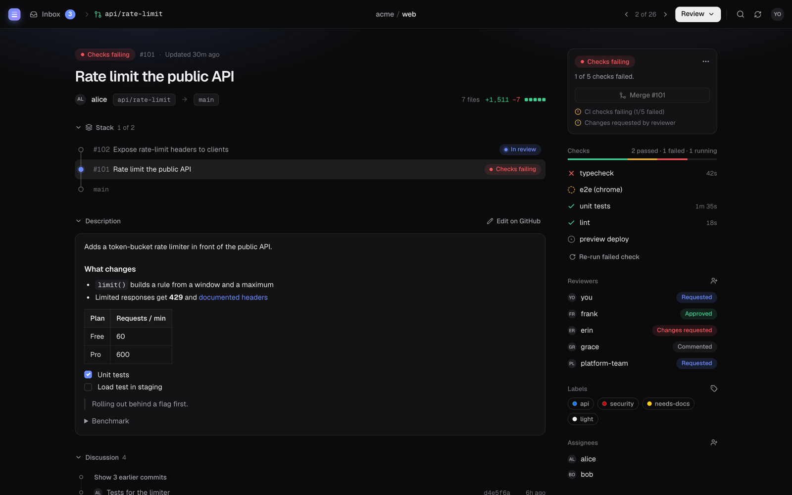

# Pile

```
       ██████╗ ██╗██╗     ███████╗
       ██╔══██╗██║██║     ██╔════╝
       ██████╔╝██║██║     █████╗
       ██╔═══╝ ██║██║     ██╔══╝
       ██║     ██║███████╗███████╗
       ╚═╝     ╚═╝╚══════╝╚══════╝
```

**The AI-native stacked PR CLI for humans.**

Pile is a command-line tool for managing stacked pull requests on GitHub. It helps you break down large changes into small, reviewable PRs that stack on top of each other.

```
        ┌───┐
        │ 3 │  ← feature-c
        └─┬─┘
        ┌─┴─┐
        │ 2 │  ← feature-b
        └─┬─┘
        ┌─┴─┐
        │ 1 │  ← feature-a
        └─┬─┘
        ──┴──  ← main
```

## Features

- **Stacked branches** - Create branches that build on each other, in a line or branching
- **Automatic rebasing** - Keep your stack in sync with `pile sync`
- **GitHub integration** - Create and update PRs with `pile submit`, merge stacks with `pile merge`
- **A review app** - `pile review` opens an inbox and diff viewer for every open PR and local branch
- **Notes for your agent** - Review an agent's work in the app, hand it over with `pile notes`
- **Offline support** - Queue operations when offline, sync when back online
- **AI-friendly** - JSON output and non-interactive mode for every command

## Installation

```bash
npm install -g pile-cli
```

Or with other package managers:

```bash
pnpm add -g pile-cli
yarn global add pile-cli
```

### From source

```bash
git clone https://github.com/vpalcar/pile.git
cd pile
pnpm install
pnpm build
pnpm -C packages/cli link --global
```

## Quick Start

```bash
# Initialize pile in your repo
pile init

# Create your first stacked branch
pile create -m "Add user authentication"

# Make changes and create another branch on top
pile create -m "Add login form"

# View your stack
pile log

# Submit PRs for your stack
pile submit --stack

# Switch branches
pile checkout            # Interactive selector
pile checkout main       # Go to trunk
pile checkout my-branch  # Go to specific branch
```

## Reviewing

`pile review` opens a local review app: an inbox of everything open, grouped by what it needs from
you, and a page per pull request with its stack, discussion, checks and diff. Comment on any line,
submit reviews, request reviewers, re-run checks and merge a PR or a whole stack, all from the
browser. Local branches show up too, so you can look over work before opening a PR.



See [docs/review.md](docs/review.md) for the full guide and keyboard shortcuts.

Reviewing work an agent wrote? Leave **notes for your agent** on any line instead of GitHub
comments, then hand them over with `pile notes` (`claude "$(pile notes)"`). The agent resolves
each one with a reply, which shows up live in the app. See
[docs/agent-notes.md](docs/agent-notes.md).

## Commands

### Stack Management

| Command | Alias | Description |
|---------|-------|-------------|
| `pile create -m "message"` | `c` | Create a new stacked branch with a commit |
| `pile log` | `l` | View the branch stack tree |
| `pile checkout [branch]` | `co` | Checkout a branch (interactive if no branch given) |
| `pile up [steps]` / `pile down [steps]` | `u` / `dn` | Move to the child / parent branch |
| `pile top` / `pile bottom` | `t` / `b` | Move to the top / bottom of the stack |
| `pile track [branch] [--parent <branch>]` | | Start tracking an existing branch |
| `pile untrack [branch]` | | Stop tracking a branch (children move to its parent) |
| `pile delete [branch]` | `del` | Delete a branch, close its PR, reparent its children |
| `pile modify` | `m` | Amend or squash commits |
| `pile rename` | `rn` | Rename the current branch |
| `pile move` | `mv` | Move branch to a different parent |
| `pile restack` | `rs` | Rebase all branches onto their parents |
| `pile sync` | | Fetch, update trunk, restack, cleanup merged |

### PR Operations

| Command | Alias | Description |
|---------|-------|-------------|
| `pile submit` | `s` | Push and create/update PR |
| `pile submit --stack` | `s -s` | Submit all PRs in the stack |
| `pile add` | `a` | Stage files for commit |
| `pile status [target]` | `st` | View PR status, reviews, CI checks |
| `pile diff [target]` | `d` | Files changed compared to the parent branch |
| `pile merge [target]` | | Merge the PR (squash by default) |
| `pile close [target]` | | Close PR without merging |
| `pile edit [target]` | | Edit PR title, body, labels, etc. |

`target` is a branch name, a PR number (`42` or `#42`) or a PR URL, and defaults to the current branch.

### Review Operations

| Command | Description |
|---------|-------------|
| `pile review [target]` | Open the review app (on a PR or branch, or the inbox) |
| `pile review --approve` | Approve the current branch's PR from the terminal |
| `pile review --request-changes -m "message"` | Request changes |
| `pile review -m "comment"` | Add a comment |
| `pile request user1 user2 [--pr <target>]` | Request review from users |

## Examples

### Creating a Stack

```bash
# Start from main
git checkout main

# Create first feature branch
pile create -m "Add database schema"

# Make more changes, create next branch
pile create -m "Add API endpoints"

# And another
pile create -m "Add frontend components"

# View the stack
pile log
```

Output:
```
  main
  │
  ○ 03-22-add-database-schema
  │
  ○ 03-22-add-api-endpoints
  │
  ● 03-22-add-frontend-components  ← you are here
```

### Submitting PRs

```bash
# Submit just the current branch
pile submit

# Submit the entire stack
pile submit --stack

# Submit as draft
pile submit --draft

# Open PR in browser after creating
pile submit --open
```

GitHub's [stacked pull requests](https://docs.github.com/en/pull-requests/get-started/about-stacked-prs)
are the source of truth: `pile submit` registers the chain from the trunk up to your branch as a
GitHub stack, adds new PRs on top of it, and rebuilds it if branches moved. GitHub stacks can't
branch, so when a stack diverges the branch that got there first keeps the GitHub stack and pile
says which PRs stay outside it.

### Syncing Your Stack

```bash
# Fetch latest, rebase stack, cleanup merged branches
pile sync
```

### Reviewing PRs

```bash
# Open the review app on the inbox, or on one PR
pile review
pile review 42

# Or review from the terminal: check out a branch and approve its PR
pile co feature-branch
pile review --approve -m "LGTM!"
pile review --request-changes -m "Please add tests"
```

## Configuration

Pile stores its configuration and branch relationships in the repository's local git config,
so nothing is added to your working tree:

```bash
git config --get-regexp '^pile\.'          # trunk, remote, mergeMethod, autoOpenPR
git config --get-regexp 'branch\..*\.pile-' # parent, base commit, title and PR of each branch
```

Set them with `pile init --trunk main --remote origin --merge-method squash`. Pile's caches and
offline queue live in `.git/pile/`. The review app's personal preferences (theme, diff layout)
live in `~/.config/pile/review.json`.

## Scripting and AI agents

Every command works without a terminal. Three global flags control this:

| Flag | Effect |
|------|--------|
| `--json` | Machine-readable output: `{ "success": true, "data": … }` or `{ "success": false, "error", "code", "hint" }` |
| `--no-interactive` | Never prompt, even in a terminal (also implied by `--json`, `CI`, or no TTY) |
| `-y, --yes` | Confirm destructive actions, such as deleting merged branches in `pile sync` |

When a command needs input it can't prompt for, it exits with code `2` and names what is
missing, including the valid choices when they are known:

```bash
$ pile checkout --json
{
  "success": false,
  "error": "No branch given and no terminal to pick one",
  "code": "NEEDS_INPUT",
  "hint": "Pass <branch>. Choices: main, add-schema, add-api",
  "data": { "arg": "branch", "choices": ["main", "add-schema", "add-api"] }
}
```

Exit codes: `0` success, `1` error, `2` needs input. `pile commands --json` describes every
command, argument and option, so agents can discover the CLI.

Pile talks to GitHub through the REST API. The one exception is switching a PR between draft and
ready for review, which GitHub only offers through GraphQL; where GraphQL is blocked (for example
in Claude Code cloud sessions) those operations fail with `GRAPHQL_UNAVAILABLE`.

## Requirements

- Node.js 20+
- Git
- GitHub account with authentication (`gh auth login` or `GITHUB_TOKEN`)

## License

MIT
