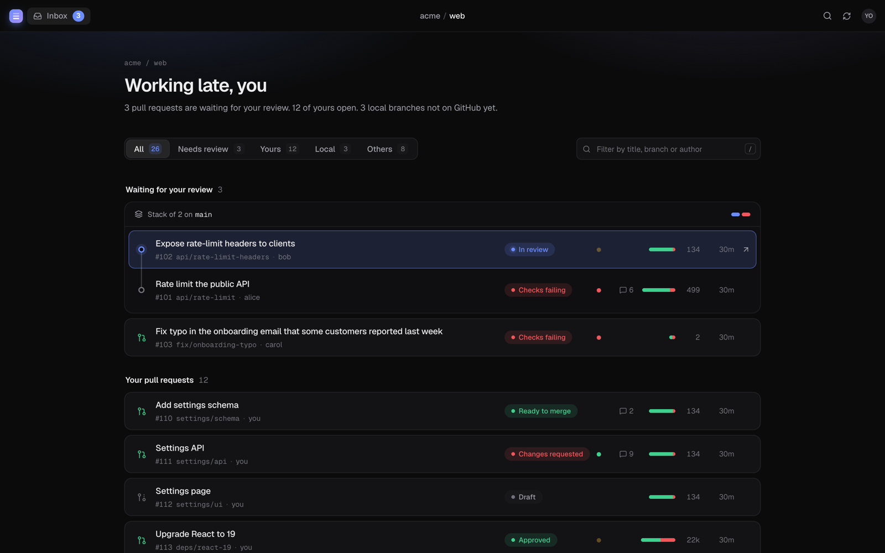
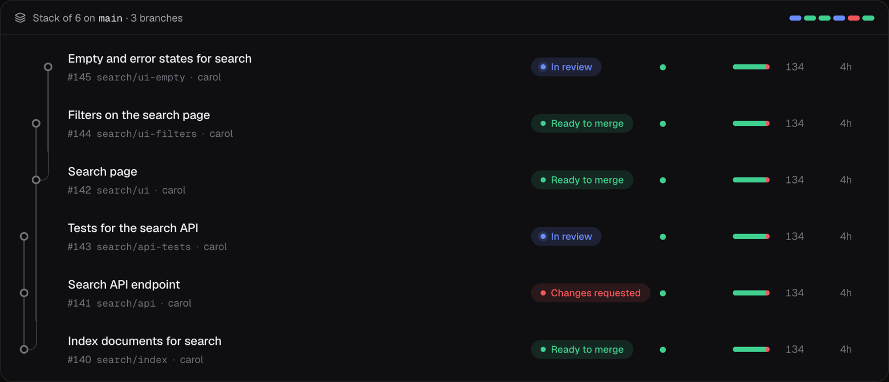
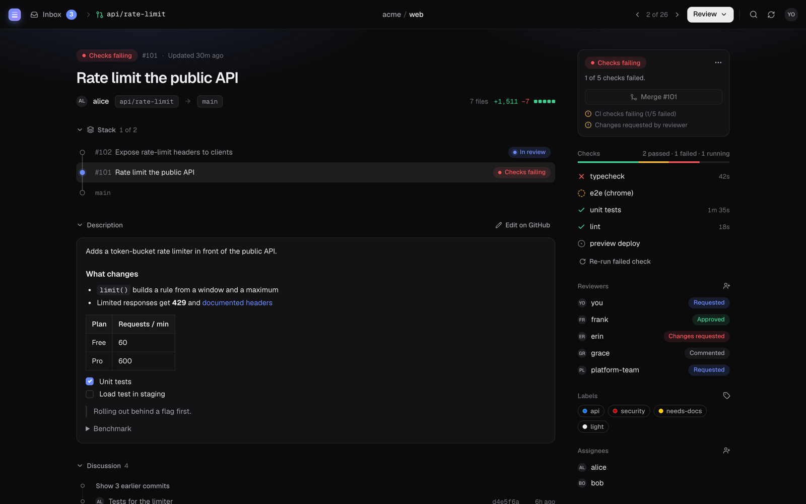
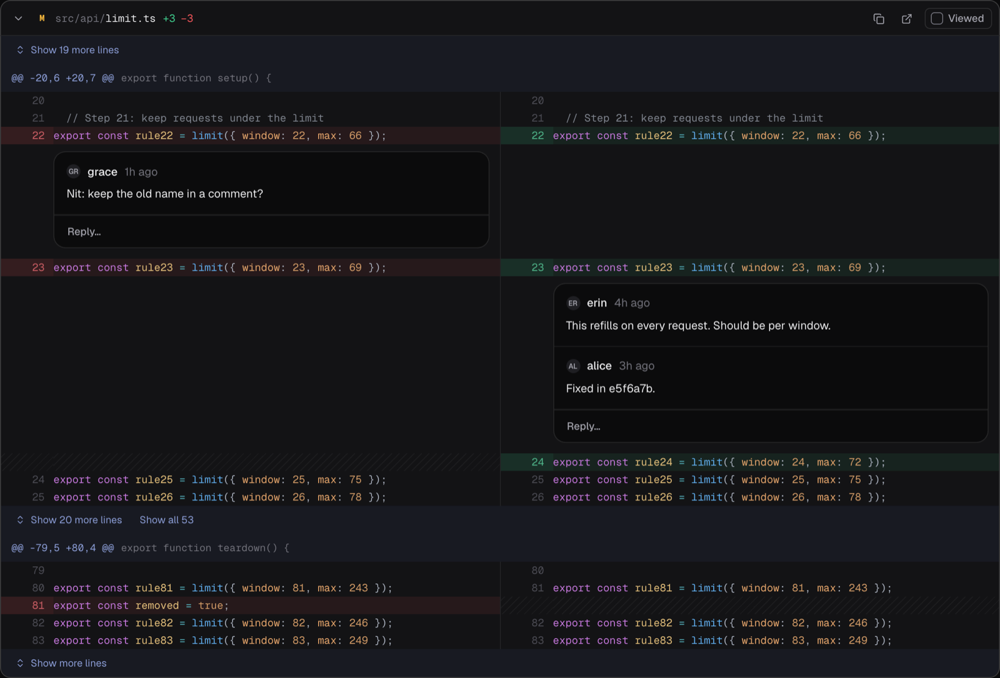
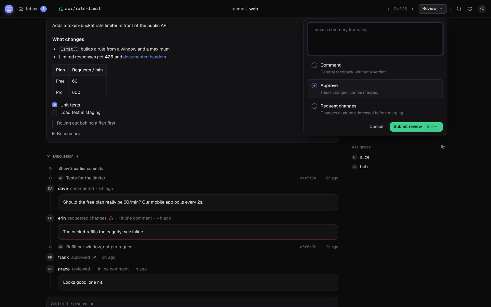

# Reviewing with `pile review`

`pile review` opens a local web app for everything that's waiting on you: pull requests to
review, your own pull requests, and local branches that aren't on GitHub yet. It runs on your
machine, talks to GitHub with your existing credentials, and understands stacks.

```bash
pile review           # the inbox
pile review 42        # straight to PR #42 (also a branch name or a PR URL)
pile review --no-open # print the link instead of opening the browser
```



## The inbox

Everything open, grouped by what it needs from you:

| Tab | What's in it |
|-----|--------------|
| **Needs review** | Pull requests where your review was requested |
| **Yours** | Pull requests you opened |
| **Local** | Branches pile tracks that have no pull request yet |
| **Others** | Everything else that's open |

Every row shows where it stands at a glance: **Draft**, **Local**, **In review**, **Changes
requested**, **Checks failing**, **Approved**, **Ready to merge**, plus its checks, comments and
size. Stacks are kept together as one card with a rail through their PRs, top of the stack
first. Search filters by title, branch, author or number (`/`), `1`–`5` switch tabs and `j` / `k`
move through the list.

### Stacks that branch

A stack doesn't have to be a straight line. When several PRs are built on the same PR, each
branch of the stack gets its own lane, like `git log --graph`:



The PR page shows the whole tree, with the PR you're on highlighted.

## A pull request



From top to bottom:

- **Stack**: every PR in the stack with its status; click one to go there. `[` and `]` step
  through the inbox.
- **Description** and **Discussion**: comments, reviews and commits in order. Write a comment at
  the bottom (`c`); unsent text is kept if you navigate away.
- **Files**: the diff, with a file tree, split or unified layout (`s`), line wrapping (`w`), and
  syntax highlighting. "Show more lines" reveals context around each change. Mark files as
  viewed (`v`) to track your progress; `j` / `k` move between files.

On the right:

- **Status**: where the PR stands, what to do next, and the **Merge** button. The `⋯` menu opens
  the PR on GitHub (`o`), copies the checkout command, and turns your own PR back into a draft.
- **Checks**: each check with its duration. Hover a GitHub Actions check to re-run it, or re-run
  every failed one at once. While checks are running the page updates by itself.
- **Reviewers**, **Labels** and **Assignees**: click the icon next to each to change them. Changes
  apply when you close the picker. Typing a label that doesn't exist creates it.

### Commenting on code

Hover a line number and click **+** to comment on that line, on either side of the diff: on new
code, or on the old code to say the previous version was better. Comments become part of your
review and are sent together when you submit it.



### Submitting a review

**Review** (`r`) in the top bar opens the review: **Comment**, **Approve** or **Request changes**,
with an optional summary and any inline comments you've written. `⌘↵` submits. On your own PR
it's **Comment** only.



### Merging

When nothing blocks it, the status card offers **Merge**:

- **Merge #42**: just this PR, when it's based on the trunk.
- **Merge stack (3)**: every open PR from the bottom of the stack up to this one. Only the PRs
  this one is built on are included, never other branches of the stack.

pile won't merge a draft, a PR with failing or running checks, one where a reviewer requested
changes, or one GitHub says can't be merged; the card lists what's in the way. These are the same
rules as `pile merge`, which also uses the same merge method (`pile init --merge-method`). PRs
above a merged one move onto its base, and branches pile tracks locally are cleaned up. Merging
asks you to confirm first.

## Local branches

Branches you haven't submitted show up too, with their diff, commits and stack, so you can look
over your own (or an agent's) work before opening a pull request. Run `pile submit` to open one.

## Keyboard

Press `?` in the app for the full list, or `⌘K` for the command palette, which jumps to any PR,
file or action.

| Keys | Action |
|------|--------|
| `⌘K` | Command palette |
| `g` / `Esc` | Back to the inbox |
| `[` / `]` | Previous / next pull request |
| `j` / `k` | Next / previous file (or inbox row) |
| `v` | Mark file viewed, go to the next |
| `s` / `w` / `t` | Split ⇄ unified, wrap lines, file tree |
| `c` / `r` / `o` | Comment, review, open on GitHub |
| `⇧R` | Refresh |

## Preferences

The theme (in the menu under your avatar), the diff layout, line wrapping and the file tree are
saved in `~/.config/pile/review.json` (or `$XDG_CONFIG_HOME/pile/review.json`), so they carry
across repositories and restarts. Each repository also gets the same port on every run, which
keeps the files you've marked as viewed and unsent comments in your browser between runs.
`--port` picks a different one.

## Privacy and security

The app only listens on `127.0.0.1`. The link `pile review` opens carries a random access token,
which the page keeps for that tab; requests without it, or addressed to any other host name, are
refused. Nothing is sent anywhere except GitHub's API, using the same credentials as the rest of
pile (`gh auth login` or `GITHUB_TOKEN`).

Without GitHub access, `pile review` still works for local branches.
